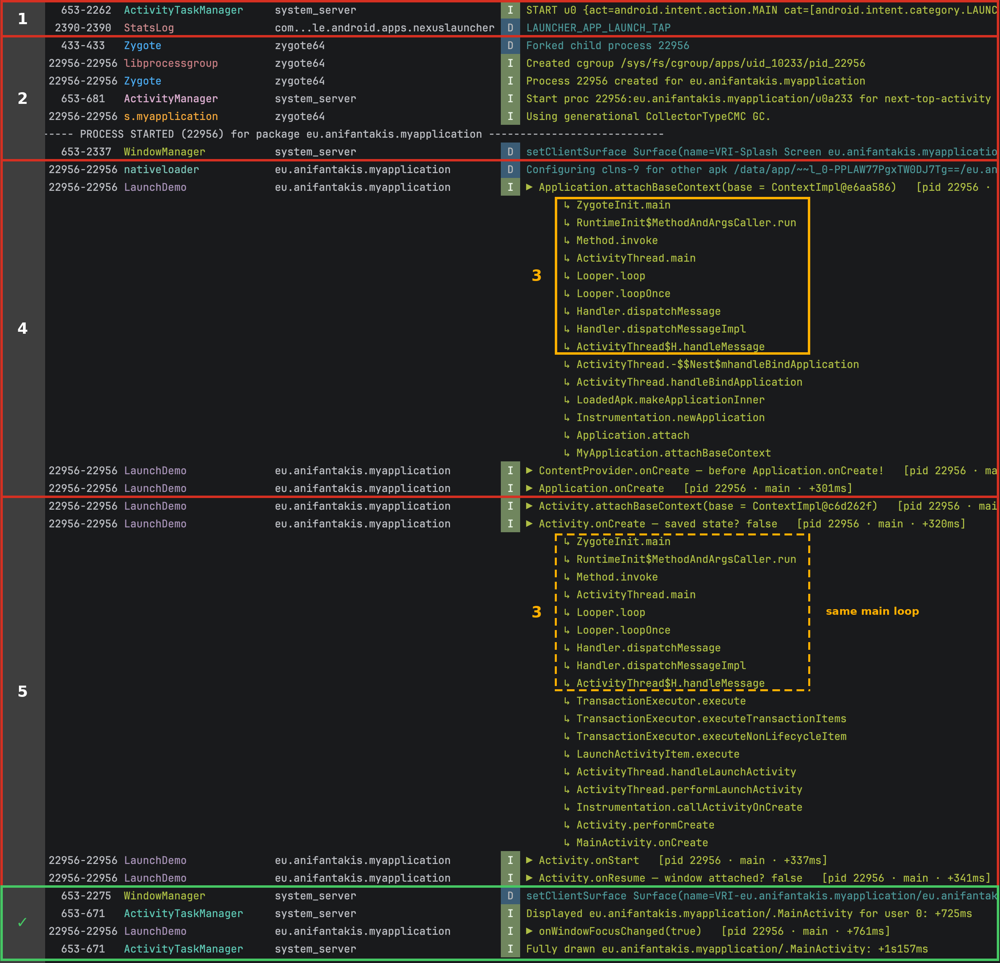
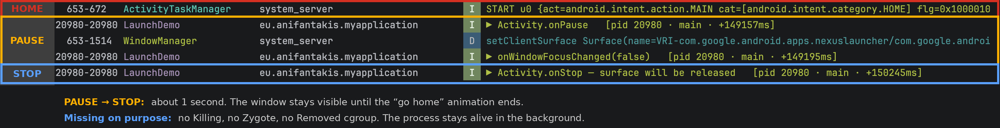
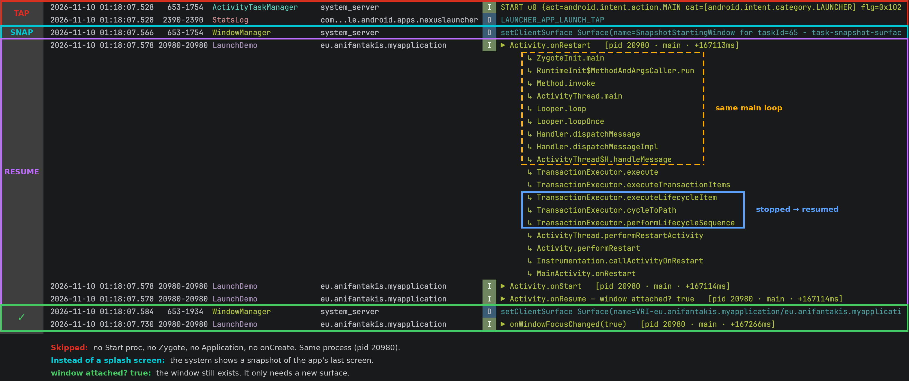
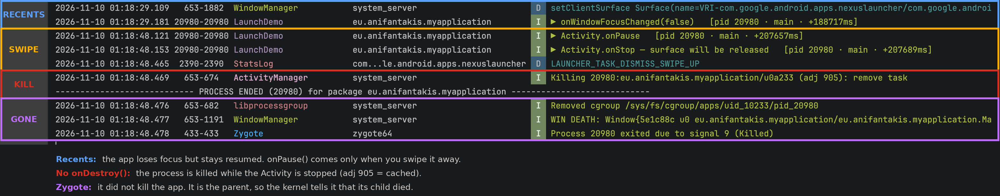

# Android Launch Lifecycle Demo

A small app that shows what happens to an app process during its life: **cold start, background, hot
start, and death**. The app logs each step with the tag `LaunchDemo`. One Logcat filter mixes these lines
with Android's own lines, in order.

## How to run it

1. Run the app once from Android Studio. This installs it.
2. Paste the [Logcat filter](#logcat-filter) into Logcat.
3. Stop the app: `adb shell am force-stop eu.anifantakis.myapplication`
4. Clear Logcat.
5. Tap the app icon → **cold start**.
6. Press Home → **background**.
7. Tap the icon again → **hot start**.
8. Open Recents and swipe the app away → **killed**.

> Tap the icon instead of pressing Run. Run reinstalls the app and starts it from the shell, not from the launcher.

## Logcat filter

```
(tag=:StatsLog & message~:'LAUNCHER_APP_LAUNCH_TAP|LAUNCHER_TASK_DISMISS') | (tag=:ActivityTaskManager & message~:'START u\d+|Displayed|Fully drawn|Force removing') | (tag=:ActivityManager & message~:'Start proc|Force stopping|Killing|Got obituary') | tag=:Zygote | (tag=:libprocessgroup & message:'/apps/') | (tag=:WindowManager & message~:'setClientSurface|WIN DEATH') | message:CollectorType | (tag=:nativeloader & message:'Configuring clns')
```

It uses only Android's own lines, so it works for any app. Add ` | tag=:LaunchDemo` at the end to also see
this app's marks.

> Keep Logcat at Verbose. The `StatsLog` lines come from Pixel Launcher. Other launchers may not write them.

## Who is who

All screenshots come from one session on an Android 17 (API 37) emulator, with `| tag=:LaunchDemo` added.

| PID | Process |
|---|---|
| `653` | `system_server`: ActivityTaskManager (ATMS), ActivityManager (AMS), WindowManager |
| `433` | `zygote64`: the parent of every app process |
| `2390` | The launcher (home screen and Recents) |
| `20980` | The app |

## 1. Cold start



Red **1–5** are the steps. Amber **3** is the main loop, inside the call paths. Green **✓**: the app is on screen.

**1 · Launch request**
- `START u0 … from uid 10196 (…nexuslauncher)` — the launcher's `startActivity()` reaches ATMS through
  Binder. Binder tells ATMS who is calling.
- `LAUNCHER_APP_LAUNCH_TAP` — the launcher's own line. It comes *after* `START`, because the Binder call is
  synchronous. Logcat shows when a line was written, not when the work started.

**2 · Create the process**
- `Forked child process 20980` — Zygote (`433`) forks itself. Copy-on-Write makes this fast.
- `Created cgroup …/pid_20980` — the PID is now `20980`: the child writes this itself, while it gets its own
  identity (uid, SELinux label, storage, name). This is *specialization*.
- `Start proc 20980:…/u0a233` — AMS logs when Zygote sends back the pid. `u0a233` = user 0, uid `10233`.
  Each process logs on its own, so this line can come after the child's lines.
- `Process 20980 created for …` — specialization is done.
- `setClientSurface … Splash Screen` — the system draws the splash screen at the same time.
- `Using … CollectorTypeCMC GC.` — the first line with the app's own name as the tag.

About 40 ms from `START` to a ready process. The rest of a cold start is initialization.

**3 · The heartbeat** (amber box)
The call path starts at `ZygoteInit.main`: the app still runs inside Zygote's `main()`, because there is no
`exec()`. `Looper.loop` → `H.handleMessage`: the main thread runs a loop and gets its work as messages.
There are no Binder frames: Binder threads only post messages to the main thread.

**4 · bindApplication**
- `Configuring clns-9 for … base.apk` — the app's own code is loaded for the first time.
- `▶ Application.attachBaseContext(ContextImpl@e6aa586)` — the system creates the `Application` and gives
  it its `Context`.
- `▶ ContentProvider.onCreate` — providers run **before** `Application.onCreate()`. App Startup and Firebase
  use this to start early.
- `▶ Application.onCreate` — your init code, before any Activity exists.

**5 · Launch the Activity**
- `▶ Activity.attachBaseContext(ContextImpl@c6d262f)` — a new `Context`, not the Application's.
- `▶ Activity.onCreate` — the same main loop, then `TransactionExecutor` → `LaunchActivityItem`:
  ATMS sent a transaction.
- `▶ onStart`, `▶ onResume — window attached? false` — resumed, but not on screen yet.

**✓ · On screen**
- `setClientSurface … MainActivity` — the window gets its surface, about 320 ms after `onResume()`.
- `Displayed +705ms` — the first frame (TTID, *time to initial display*).
- `Fully drawn +1s139ms` — the app says its content is ready with `ReportDrawnWhen` (TTFD, *time to full display*).

## 2. Press Home



- **HOME** — `START … category.HOME … result code=2`: Home is just another start. The launcher is already
  running, so its task is only brought to the front.
- **PAUSE** — `onPause()` right away: the app lost the foreground.
- **STOP** — `onStop()` about 1 s later: the app is no longer visible, after the animation ends.

The process stays alive: no `Killing`, no Zygote line. You can check how important it is now:

```
adb shell 'cat /proc/$(pidof eu.anifantakis.myapplication)/oom_score_adj'
```

`0` on screen, higher after Home (often `700`). Higher numbers are killed first.

## 3. Open it again: hot start



- **TAP** — the same request as a cold start.
- **SNAP** — no splash screen: the system shows a snapshot of the app's last screen.
- **RESUME** — same pid, same Activity. `cycleToPath` walks it from *stopped* to *resumed*:
  `onRestart` → `onStart` → `onResume`. The window is still attached.
- **✓** — the window gets a new surface and the focus.

No `Start proc`, no Zygote, no `Application`, no `onCreate()`.

| Start | Process | Activity |
|---|---|---|
| Cold | Created by Zygote | Created |
| Warm | Exists | Created again (`onCreate` with its saved state) |
| Hot | Exists | Exists, brought to the front |

To see a warm start, turn on **Developer options › Don't keep activities**, press Home, then tap the icon.
(Since Android 12, Back on the first Activity works like Home, so it also gives a hot start.)

## 4. Swipe it away in Recents



- **RECENTS** — the app loses focus, but there is no `onPause()`: in Recents it is still resumed.
- **SWIPE** — `onPause()`, `onStop()`, and the launcher asks ATMS to remove the task.
- **KILL** — `Killing … (adj 905): remove task`. Nothing is left in the process, so AMS kills it.
  `adj 905` means *cached*: the first to go.
- **GONE** — the cgroup is removed, WindowManager learns the window died (`WIN DEATH`), and Zygote, the
  parent, reports `signal 9`.

There is no `onDestroy()`. `onStop()` can be the last callback your app gets.

**A force stop is different** (the Stop button or `am force-stop`, with the app on screen): no `onPause()`
or `onStop()` at all, `adj 0`, AMS kills first and ATMS cleans up after (`app died, no saved state`), and
`Got obituary` shows Binder telling AMS. The app is also put in the *stopped* state: no alarms, jobs or
broadcasts until the user opens it again.

## How it works: LaunchTrace

[LaunchTrace.kt](app/src/main/java/eu/anifantakis/myapplication/LaunchTrace.kt) writes every `LaunchDemo` line:

```
▶ <step>   [pid <pid> · <thread> · +<ms since the system asked for the process>]
```

With `showPath = true`, it also writes the call path:

```kotlin
private fun callPath(): String = Throwable().stackTrace
    .filter { f -> keep.any { f.className.startsWith(it) } && !f.className.startsWith(LaunchTrace::class.java.name) }
    .map { "${it.className.substringAfterLast('.')}.${it.methodName}" }
    .distinct()
    .reversed()
    .joinToString("\n") { "      ↳ $it" }
```

It takes the current stack trace (without throwing), keeps only the frames in the `keep` list (Zygote,
`Looper`/`Handler`, `android.app`, the app's own code), shortens the names, removes repeats, and reverses
the order. You read it from `ZygoteInit.main` down to your callback.

`Context.describe()` prints `ClassName@hash`, so you can see if two `Context` objects are the same.

## Project layout

| File | What it does |
|---|---|
| [LaunchTrace.kt](app/src/main/java/eu/anifantakis/myapplication/LaunchTrace.kt) | The logger: `mark()`, `markOnce()`, `callPath()`, `Context.describe()`. |
| [MyApplication.kt](app/src/main/java/eu/anifantakis/myapplication/MyApplication.kt) | Marks `attachBaseContext` (with call path) and `onCreate`. |
| [DemoInitProvider.kt](app/src/main/java/eu/anifantakis/myapplication/DemoInitProvider.kt) | An empty `ContentProvider`, to show that providers run before `Application.onCreate()`. |
| [MainActivity.kt](app/src/main/java/eu/anifantakis/myapplication/MainActivity.kt) | Marks every lifecycle callback. Fakes a 400 ms load, then reports "fully drawn". |
| [AndroidManifest.xml](app/src/main/AndroidManifest.xml) | Registers the Application, the Activity and the provider. |

Requirements: minSdk 28, compileSdk and targetSdk 37.

## Notes

- **Timings include debug overhead**: a debug build, plus a small Android Studio agent that the app loads
  on every start. To remove the agent (Run adds it back):
  `adb shell run-as eu.anifantakis.myapplication rm -rf code_cache/startup_agents code_cache/.studio`
- **Look at the order, not the numbers.** Timings change between runs, and lines from different processes
  can swap places.
- **The `ContextImpl` hashes repeat** on every cold start, and change only after a reboot. A likely reason:
  every process starts as a copy of the same Zygote.
- **`Throwable().stackTrace` is slow.** This is demo code. Do not ship it.