# Android Internals Deep Dive

**Context · Binder IPC · Zygote**

Companion demo for the talk ***The Android Internals Deep Dive — Context, Binder IPC, Zygote***.

> **IMPORTANT: This is not another lifecycle demo.**
>
> It shows what happens *below* the lifecycle: how Android OS handles the creation an app process. 
> 
> You tap an icon, and Logcat lets you follow the journey through the system logs.
>
> You will see the lifecycle too, as a bonus: the callbacks show *when* each step reaches your code. But the
> talk and this repo are about how Android creates an app process, brings the app back, and kills the process.

Along the way, you see:

- the launcher's request reaching **ATMS** inside `system_server`, through a **Binder** call,
- **AMS** asking **Zygote** for a new process, through Zygote's socket,
- Zygote **forking** itself, and the child **specializing** into your app: its uid, its SELinux label,
  its cgroup, its name,
- the new process starting its main thread, and the system's orders arriving through Binder —
  `bindApplication`, then the Activity transaction — as messages on that thread's loop.

Most of what you see are Android's own log lines, written by `system_server` and Zygote: you get the same
lines for **any app**. A few marks from this demo app (tag `LaunchDemo`) fill the gaps that Android does
not log.

After the cold start, the same filter follows the process through a rotation, the background and a hot
start, where you can see what does **not** happen: no fork, no new process. At the end, the system kills
the process, and Zygote, its parent, reports the death.

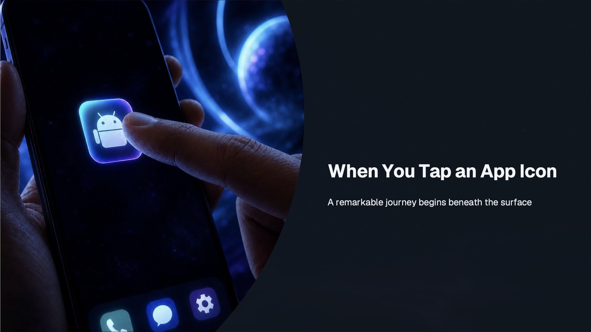

## Logcat filter

Paste this filter into Android Studio's Logcat:

```
(tag=:StatsLog & message~:'LAUNCHER_APP_LAUNCH_TAP|LAUNCHER_TASK_DISMISS') | (tag=:ActivityTaskManager & message~:'START u\d+|Displayed|Fully drawn|Force removing') | (tag=:ActivityManager & message~:'Start proc|Force stopping|Killing|Got obituary') | tag=:Zygote | (tag=:libprocessgroup & message:'/apps/') | (tag=:WindowManager & message~:'setClientSurface|WIN DEATH') | message:CollectorType | (tag=:nativeloader & message:'Configuring clns')
```

It uses only Android's own lines, so it works for any app. Add ` | tag=:LaunchDemo` at the end to also see
this app's marks.

> **To try it:** run the app once from Android Studio, then force-stop it
> (`adb shell am force-stop eu.anifantakis.myapplication`), clear Logcat, and **tap the app icon**.
> Don't use the Run button: it starts the app from the shell, so the launcher's lines don't appear.

## Who is who

All screenshots come from one session on an Android 17 (API 37) emulator.

Each section shows **two screenshots of the same moment**, one under the other:

- **Log without `| tag=:LaunchDemo`** — the filter as it is: Android's own lines, the same for every app.
- **Log with `| tag=:LaunchDemo`** — the same lines, plus the marks this demo app writes from its own code:
  the `Application`, the providers and every Activity callback, with their call paths.

Below them, **Line by line** explains every line in both screenshots.

| PID | Process |
|---|---|
| `653` | `system_server`: ActivityTaskManager (ATMS), ActivityManager (AMS), WindowManager |
| `433` | `zygote64`: the parent of every app process |
| `2390` | The launcher (home screen and Recents) |
| `22956` | The app |

## 1. Cold start

### Log without `| tag=:LaunchDemo`

*Note: this is the default log. You get the same lines for every app, with no code in it.
Gray `⋯` rows mark where the app runs code that writes no system line.*

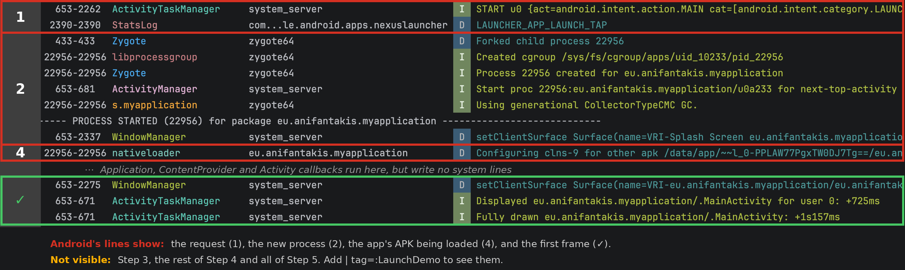

### Log with `| tag=:LaunchDemo`

*Note: this adds the marks that this demo app writes from its own code. Your app does not write them,
so you will not see them in your app's log.*


The system shows the request (1), the new process (2), the app's APK being loaded (4) and the first frame
(✓). Step 3, the rest of Step 4 and all of Step 5 happen inside the app and write no system line.

Red **1–5** are the steps. Amber **3** is the main loop, inside the call paths. Green **✓**: the app is on screen.

### Line by line

Each step starts with its slide from the talk: **what happens**. The lines under it show **where you can see it** in the log.

#### Step 1 · Launch request

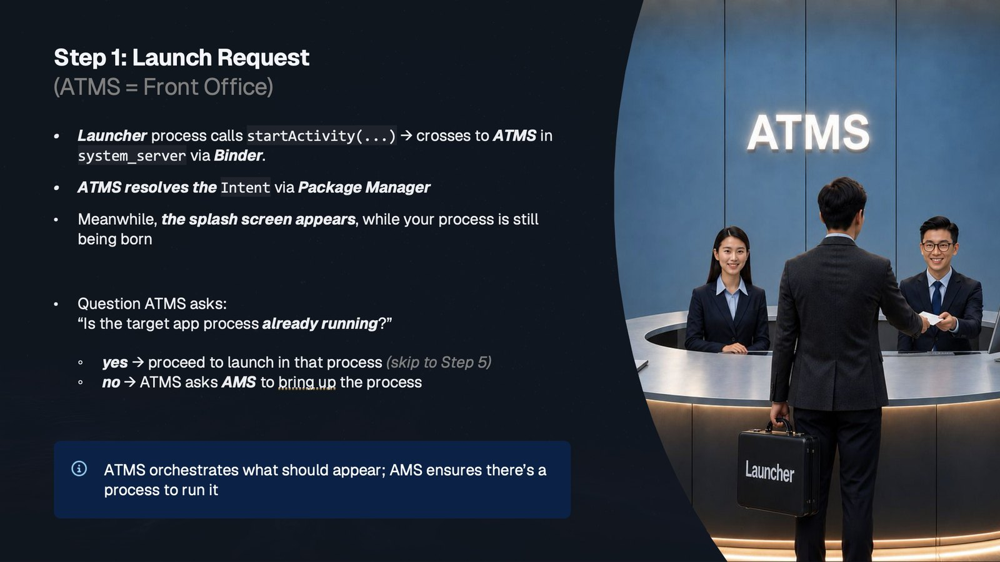

- **`ActivityTaskManager` · `START u0 {act=…MAIN cat=[…LAUNCHER] … cmp=eu.anifantakis.myapplication/.MainActivity}`**
  (system_server) — The launcher called `startActivity()`. The call crossed into `system_server` through
  Binder, and ATMS writes this line while it handles it. `cmp=` is the Activity that ATMS found in the app's
  Manifest. At the end of the line (scroll right), ATMS names the caller:
  `from uid 10196 (com.google.android.apps.nexuslauncher)`. Binder always tells the system who is calling.
- **`StatsLog` · `LAUNCHER_APP_LAUNCH_TAP`** (the launcher, `2390`) — The launcher's own line about the tap.
  It comes *after* `START`, because `startActivity()` is a synchronous Binder call: the launcher waits until
  ATMS is done, and only then writes its line.

#### Step 2 · The identity: create the process

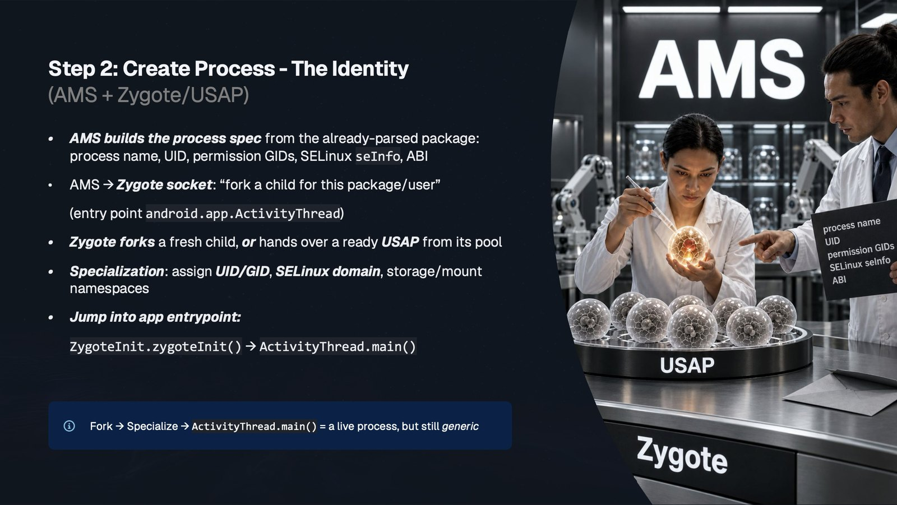

- **`Zygote` · `Forked child process 22956`** (Zygote, `433-433`) — Zygote forks itself. The child is a copy
  of Zygote: it shares Zygote's memory (Copy-on-Write), so the fork is fast.
- **`libprocessgroup` · `Created cgroup /sys/fs/cgroup/apps/uid_10233/pid_22956`** — Look at the PID column:
  `22956`. **The child writes this line itself.** It starts its *specialization*: it puts itself in its own
  control group (cgroup), so the system can track and limit its CPU and memory, and later kill it. In the
  same few milliseconds it also gets its uid (`10233`), its SELinux label, its own view of storage, and its
  name. The process column still says `zygote64`: the child has not been renamed yet.
- **`Zygote` · `Process 22956 created for eu.anifantakis.myapplication`** (`22956`) — The child reports that
  specialization is done. Same PID: it is the same process, not a second one.
- **`ActivityManager` · `Start proc 22956:eu.anifantakis.myapplication/u0a233 for next-top-activity`**
  (system_server) — AMS asked Zygote for this process, but it writes its line **only when Zygote sends back
  the new PID**. That is why the line already contains `22956`. `u0a233` means user 0, app 233, which is
  uid `10233`. `for next-top-activity` is the reason: ATMS needs the process for the Activity that is about
  to be on top.
- **`s.myapplication` · `Using generational CollectorTypeCMC GC.`** (`22956`) — ART, the Android runtime that
  came from Zygote, sets up its garbage collector for this process. The tag is now the app's own name
  (Linux keeps only the last 15 characters: `s.myapplication`).
- **`PROCESS STARTED (22956)`** — Android Studio's marker. From here, the process column shows the app's name.
- **`WindowManager` · `setClientSurface … Splash Screen eu.anifantakis.myapplication`** (system_server) —
  The system gives the splash screen window its surface (the memory buffer it draws into). The system
  draws the splash screen while the app's process is still starting. Its position changes between runs,
  because both things happen at the same time.

Only a few dozen milliseconds pass from `START` to a ready process. The rest of a cold start is
initialization.

#### Why do we see Zygote before AMS?

The talk says: ATMS gets the request, ATMS asks AMS for a process, and AMS asks Zygote to fork. But Logcat
shows `START` (ATMS), then Zygote's `Forked child process`, and AMS's `Start proc` only later. Both are true,
because **Logcat shows when a line was written, not when the work started**:

```
ATMS   writes START, sees there is no process, asks AMS     ← an internal call: no log line
AMS    sends the process spec to Zygote's socket, waits     ← no log line yet
Zygote forks, writes "Forked child process 22956"           ← first line about the new process
Child  starts specializing right away: cgroup, "created for"
Zygote sends the PID back to AMS
AMS    writes "Start proc 22956:…"                          ← AMS asked first, but writes last
```

Each process writes its own lines, at its own time. Here, the child was even faster than AMS.

#### What if the device uses a USAP pool?

Some devices keep a pool of *unspecialized app processes* (USAPs): Zygote forks a few processes **before**
any app needs them, and they wait, named `usap64`. This emulator does not use the pool: Zygote forks right
after `START`. With a pool, based on the Zygote source:

- The `Forked child process` line for your app's process appears **long before the tap**, when Zygote fills
  the pool. At launch time, you don't see a fork for your app.
- At launch, AMS sends the spec to one of the waiting USAPs. That process specializes itself, so you still
  see `Created cgroup`, the specialization lines and `Start proc` at launch time.
- Your app's PID is the one the USAP got when it was forked.
- After the launch, Zygote refills the pool: new `Forked child process` lines for processes that are not
  your app.

From Step 3 on, nothing changes. To check a device: `adb shell getprop | grep usap` and
`adb shell ps -A | grep usap`.

#### Step 3 · The heartbeat (amber box)

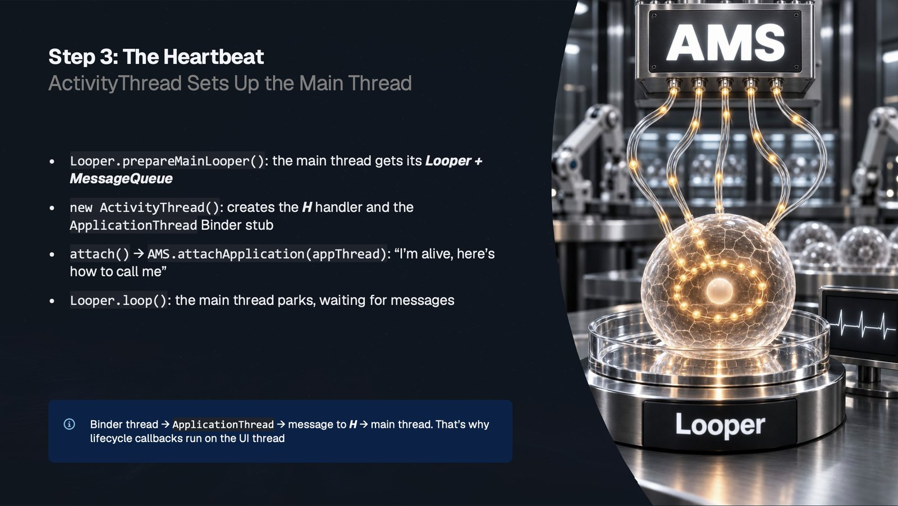

There is no system line for this step. The proof is the first part of the call path under
`Application.attachBaseContext`:

- **`ZygoteInit.main` → `RuntimeInit$MethodAndArgsCaller.run` → `Method.invoke`** — The app's main thread
  was Zygote's main thread. After the fork, the process continues inside Zygote's `main()`, because there is
  no `exec()`. Zygote finds the app's entry point and calls it through reflection.
  The Step 2 slide says `ZygoteInit.zygoteInit()` → `ActivityThread.main()`. `zygoteInit()` finds
  `ActivityThread.main`, wraps it in a small object (`MethodAndArgsCaller`) and returns. Back in
  `ZygoteInit.main`, the child then runs it. That's why the path shows `ZygoteInit.main` and
  `MethodAndArgsCaller.run`, but not `zygoteInit`: it had already returned.
- **`ActivityThread.main`** — The app's entry point. It prepares the main thread's loop and tells AMS,
  through Binder, "I'm alive, here's how to call me" (not in the log).
- **`Looper.loop` → `Looper.loopOnce` → `Handler.dispatchMessage` → `ActivityThread$H.handleMessage`** — The
  main thread runs a loop. Each turn takes one message and gives it to `H`, a `Handler` that decides what
  the message means.

There are **no Binder frames** here. When the system calls the app through Binder, the call arrives on a
separate Binder thread. That thread only puts a message in the main thread's queue.

#### Step 4 · The DNA: bindApplication

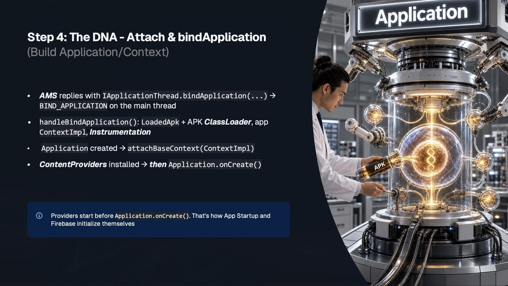

- *Not in the log:* AMS answers "I'm alive" with `bindApplication()`. It arrives as a message for `H`.
- **`nativeloader` · `Configuring clns-9 for other apk /data/app/…/base.apk. target_sdk_version=37, …`**
  (`22956`) — While handling that message, the app creates the **class loader for its own APK**. Zygote
  preloaded the Android framework. This is the first time the app's own code can be loaded. `nativeloader`
  is the part of Android that loads native (`.so`) libraries, and `clns-9` is the *class loader namespace*
  it creates for this class loader: the rules for which native libraries the app's code may load
  (`library_path` is the APK's `lib` folder, `permitted_path` is where the app may load from).
- **`LaunchDemo` · `▶ Application.attachBaseContext(base = ContextImpl@e6aa586)`** — The system creates the
  `Application` and plugs in its `Context` (`ContextImpl`). After the amber main loop, the call path shows
  how: `H.handleMessage` → `handleBindApplication` → `LoadedApk.makeApplicationInner` →
  `Instrumentation.newApplication` → `Application.attach` → `MyApplication.attachBaseContext`. The system
  creates the `Application`; the app never calls its constructor.
  (`-$$Nest$mhandleBindApplication` is a helper method that the compiler adds. You can ignore it.)
- **`LaunchDemo` · `▶ ContentProvider.onCreate — before Application.onCreate!`** — Content providers start
  **between** `attachBaseContext` and `onCreate`. Libraries such as App Startup and Firebase use this to
  start before your own code.
- **`LaunchDemo` · `▶ Application.onCreate`** (`+301ms`) — Your own initialization, before any Activity exists.

#### Step 5 · The face: launch the Activity

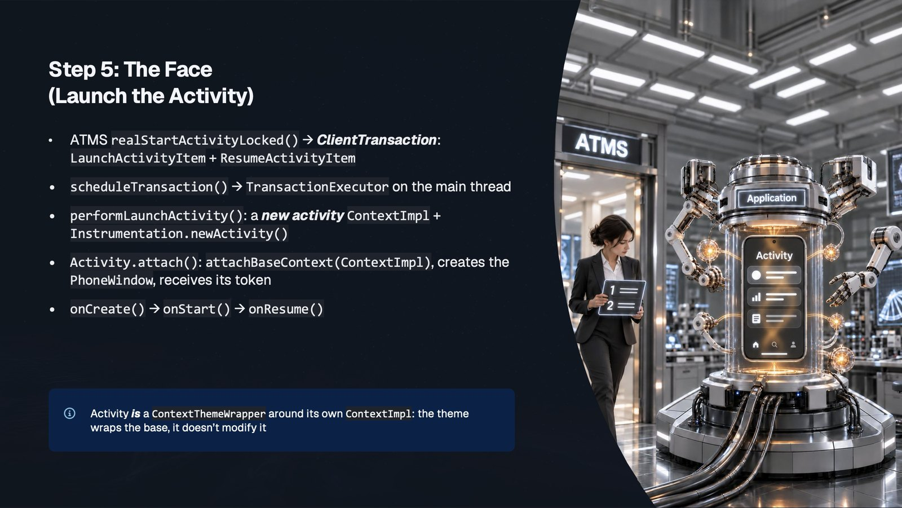

- *Not in the log:* AMS tells ATMS that the process is ready. ATMS sends the app a *transaction* through
  Binder: "create this Activity, then resume it".
- **`LaunchDemo` · `▶ Activity.attachBaseContext(base = ContextImpl@c6d262f)`** — A new `ContextImpl` for the
  Activity. The hash is different from the Application's (`@e6aa586`): two different objects.
- **`LaunchDemo` · `▶ Activity.onCreate — saved state? false`** (`+320ms`) — A brand-new Activity, with no
  saved state. The call path starts with the same main loop. Then it splits at `H.handleMessage`:
  `TransactionExecutor.execute` → `LaunchActivityItem.execute` → `handleLaunchActivity` →
  `performLaunchActivity` → `Instrumentation.callActivityOnCreate` → `MainActivity.onCreate`.
  `LaunchActivityItem` is the "create this Activity" part of ATMS's transaction.
- **`LaunchDemo` · `▶ Activity.onStart`** and **`▶ Activity.onResume — window attached? false`** — The
  slide's `ResumeActivityItem` is the second part of the same transaction: `TransactionExecutor` walks the
  new Activity to *resumed*, which calls `onStart()` and `onResume()`. The Activity is resumed, but its
  window is not on screen yet.

#### ✓ · On screen

- **`WindowManager` · `setClientSurface … MainActivity`** (system_server) — The Activity's window gets its
  surface, a few hundred ms **after** `onResume()`.
- **`ActivityTaskManager` · `Displayed eu.anifantakis.myapplication/.MainActivity for user 0: +725ms`** — The
  first frame is on screen, 725 ms after `START` (TTID, *time to initial display*).
- **`LaunchDemo` · `▶ onWindowFocusChanged(true)`** — The window gets input focus. The user can interact now.
- **`ActivityTaskManager` · `Fully drawn …: +1s157ms`** — The app pretends to load data for 400 ms, then calls
  `ReportDrawnWhen { loaded }`. This is when the app says "my content is ready" (TTFD, *time to full display*).

## 2. Rotate the screen

### Log without `| tag=:LaunchDemo`

*Note: this is the default log. You get the same lines for every app, with no code in it.
Gray `⋯` rows mark where the app runs code that writes no system line.*

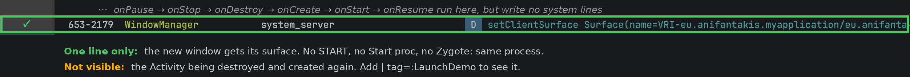

### Log with `| tag=:LaunchDemo`

*Note: this adds the marks that this demo app writes from its own code. Your app does not write them,
so you will not see them in your app's log.*

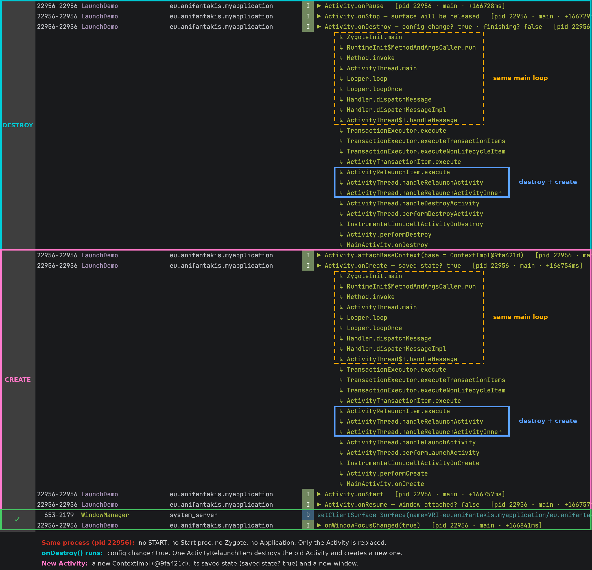

A single line: the new window gets its surface. Without the app's own marks, you can't see that the
Activity was destroyed and created again.

### Line by line

There is no `START` line: nobody asked to start an Activity. ATMS sees the new screen orientation and sends
the app one transaction: *relaunch this Activity*.

**DESTROY**
- **`LaunchDemo` · `▶ Activity.onPause`** and **`▶ Activity.onStop`** — The old Activity leaves the screen.
- **`LaunchDemo` · `▶ Activity.onDestroy — config change? true · finishing? false`** — The old Activity is
  destroyed because the configuration changed, not because it is finishing. The call path: the same main
  loop, then `TransactionExecutor` → `ActivityRelaunchItem.execute` → `handleRelaunchActivity` →
  `handleRelaunchActivityInner` → `handleDestroyActivity` → … → `MainActivity.onDestroy`.

**CREATE**
- **`LaunchDemo` · `▶ Activity.attachBaseContext(base = ContextImpl@9fa421d)`** — A new Activity object, with
  a new `ContextImpl`.
- **`LaunchDemo` · `▶ Activity.onCreate — saved state? true`** — The new Activity gets the old one's saved
  state. The call path goes through the **same** `ActivityRelaunchItem` → `handleRelaunchActivityInner`, now
  to `handleLaunchActivity`. One relaunch item does both halves: destroy, then create.
- **`LaunchDemo` · `▶ Activity.onStart`** and **`▶ Activity.onResume — window attached? false`** — The new
  Activity has a new window, not yet on screen.

**✓**
- **`WindowManager` · `setClientSurface … MainActivity`** — The new window gets its surface.
- **`LaunchDemo` · `▶ onWindowFocusChanged(true)`** — The new window gets the focus.

Same PID (`22956`): no `Start proc`, no Zygote, no `Application` lines. The system replaces **only the
Activity**. The saved state is what `rememberSaveable` and `SavedStateHandle` keep for you.

## 3. Press Home

### Log without `| tag=:LaunchDemo`

*Note: this is the default log. You get the same lines for every app, with no code in it.
Gray `⋯` rows mark where the app runs code that writes no system line.*

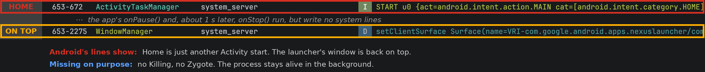

### Log with `| tag=:LaunchDemo`

*Note: this adds the marks that this demo app writes from its own code. Your app does not write them,
so you will not see them in your app's log.*


Home is just another Activity start, and the launcher's window is back on top. The app itself writes
nothing: its `onPause()` and `onStop()` are invisible.

### Line by line

- **HOME · `ActivityTaskManager` · `START u0 {act=…MAIN cat=[android.intent.category.HOME] …}`** — Pressing
  Home is just another Activity start: the system starts the launcher's HOME Activity. The launcher is already
  running, so there is no `Start proc` and no fork. Its task is only brought to the front.
- **PAUSE · `LaunchDemo` · `▶ Activity.onPause`** — Right away: the app lost the foreground.
- **PAUSE · `WindowManager` · `setClientSurface … NexusLauncherActivity`** — The launcher's window gets its
  surface back.
- **PAUSE · `LaunchDemo` · `▶ onWindowFocusChanged(false)`** — The app has no input focus anymore.
- **STOP · `LaunchDemo` · `▶ Activity.onStop — surface will be released`** — About 1 s later. `onPause()`
  means "you lost the foreground". `onStop()` means "you are no longer visible": the app's window stays
  visible until the "go home" animation ends.

No `onDestroy()`, no `Killing`, no Zygote line: the Activity and the process stay alive. You can check how
important the process is now:

```
adb shell 'cat /proc/$(pidof eu.anifantakis.myapplication)/oom_score_adj'
```

`0` on screen, higher after Home (often `700`). Higher numbers are killed first.

## 4. Open it again: hot start

### Log without `| tag=:LaunchDemo`

*Note: this is the default log. You get the same lines for every app, with no code in it.
Gray `⋯` rows mark where the app runs code that writes no system line.*

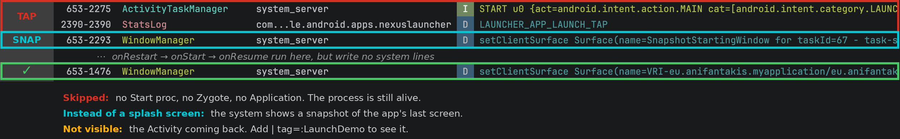

### Log with `| tag=:LaunchDemo`

*Note: this adds the marks that this demo app writes from its own code. Your app does not write them,
so you will not see them in your app's log.*


The tap, the snapshot and the new surface. No `Start proc` and no Zygote line: the process is still alive.

### Line by line

- **TAP · `ActivityTaskManager` · `START u0 {…LAUNCHER…}`** and **`StatsLog` · `LAUNCHER_APP_LAUNCH_TAP`** —
  The same request as in a cold start.
- **SNAP · `WindowManager` · `setClientSurface Surface(name=SnapshotStartingWindow for taskId=67 …)`** — No
  splash screen this time. The system shows a **snapshot**: a picture of the app's last screen, saved when
  the app went to the background. The user sees the app at once.
- **RESUME · `LaunchDemo` · `▶ Activity.onRestart`** — Same PID, same Activity. The call path: the same main
  loop, then `TransactionExecutor.executeLifecycleItem` → `cycleToPath` → `performLifecycleSequence` →
  `performRestartActivity` → … → `MainActivity.onRestart`. ATMS asked for the state *resumed*. The Activity
  is *stopped*, so `cycleToPath` walks it through every state in between.
- **RESUME · `LaunchDemo` · `▶ Activity.onStart`** and **`▶ Activity.onResume — window attached? true`** —
  All three callbacks run in the same millisecond. The window is still **attached**: `onStop()` only
  released its surface.
- **✓ · `WindowManager` · `setClientSurface … MainActivity`** — The window gets a new surface.
- **✓ · `LaunchDemo` · `▶ onWindowFocusChanged(true)`** — The user can interact again.

No `Start proc`, no Zygote, no `Application`, no `onCreate()`.

| Start | Process | Activity |
|---|---|---|
| Cold | Created by Zygote | Created |
| Warm | Exists | Created again (`onCreate` with its saved state) |
| Hot | Exists | Exists, brought to the front |

To see a warm start, turn on **Developer options › Don't keep activities**, press Home, then tap the icon.
(Since Android 12, Back on the first Activity works like Home, so it also gives a hot start.)

## 5. Swipe it away in Recents

### Log without `| tag=:LaunchDemo`

*Note: this is the default log. You get the same lines for every app, with no code in it.
Gray `⋯` rows mark where the app runs code that writes no system line.*

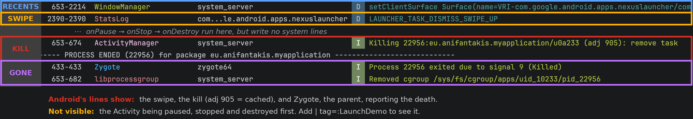

### Log with `| tag=:LaunchDemo`

*Note: this adds the marks that this demo app writes from its own code. Your app does not write them,
so you will not see them in your app's log.*


Recents, the swipe, the kill and the death report. From these lines alone, it looks as if the process was
simply killed.

The app's marks show what happened first: the Activity was paused, stopped and **destroyed** before AMS
killed the empty process.

### Line by line

- **RECENTS · `WindowManager` · `setClientSurface … NexusLauncherActivity`** — The Recents button was pressed.
  The launcher, which shows Recents, is on top again.
- **RECENTS · `LaunchDemo` · `▶ onWindowFocusChanged(false)`** — The app loses focus, but there is no
  `onPause()`: in Recents it is still resumed, as a live tile.
- **SWIPE · `StatsLog` · `LAUNCHER_TASK_DISMISS_SWIPE_UP`** — The launcher's line about the swipe. It asks
  ATMS, through Binder, to remove the app's task.
- **SWIPE · `LaunchDemo` · `▶ Activity.onPause`** and **`▶ Activity.onStop`** — The Activity leaves the screen.
- **DESTROY · `LaunchDemo` · `▶ Activity.onDestroy — config change? false · finishing? true`** — Removing the
  task also **finishes** the Activity. The call path shows `DestroyActivityItem`: a transaction from ATMS
  that says "destroy this Activity".
- **KILL · `ActivityManager` · `Killing 22956:eu.anifantakis.myapplication/u0a233 (adj 905): remove task`** —
  The process is now empty, so AMS kills it (signal 9 to its cgroup). `adj` is the importance score that AMS
  keeps for every process: `0` on screen, `900` and higher for *cached* processes, which are killed first.
- **KILL · `PROCESS ENDED (22956)`** — Android Studio's marker.
- **GONE · `Zygote` · `Process 22956 exited due to signal 9 (Killed)`** (`433`) — Zygote did not kill the
  app. Zygote is the **parent**, and the kernel tells the parent when a child dies. The same PID `433`
  forked the process in Step 2.
- **GONE · `libprocessgroup` · `Removed cgroup …/pid_22956`** (system_server) — The cgroup that the child
  created in Step 2 is removed.

### When is `onDestroy()` skipped?

When the process dies first:

- **Force stop** (the Stop button or `am force-stop`, with the app on screen): no `LaunchDemo` lines at all.
  This is where the other parts of the filter show up: `ActivityManager` · `Force stopping …` and
  `Killing … (adj 0)`, then `ActivityTaskManager` · `Force removing ActivityRecord … app died, no saved state`,
  `ActivityManager` · `Got obituary of 22956` (Binder tells AMS that the process is gone), and
  `WindowManager` · `WIN DEATH` (Binder tells WindowManager that the window's process is gone). A force stop
  also puts the app in the *stopped* state: no alarms, jobs or broadcasts until the user opens it again.
- **The system kills a background process** to free memory. Try it: press Home, run
  `adb shell am kill eu.anifantakis.myapplication`, then tap the icon. The old Activity never gets
  `onDestroy()`. You get a full cold start, but with `Activity.onCreate — saved state? true`: the system kept
  the Activity's saved state even though the process died.

So `onStop()` is the last callback you can count on. Save important state there, not in `onDestroy()`.

## How it works: LaunchTrace

[LaunchTrace.kt](app/src/main/java/eu/anifantakis/myapplication/LaunchTrace.kt) writes every `LaunchDemo` line:

```
▶ <step>   [pid <pid> · <thread> · +<ms since the system asked for the process>]
```

With `showPath = true`, it also writes the call path:

```kotlin
private fun callPath(): String = Throwable().stackTrace
  .filter { f -> keep.any { f.className.startsWith(it) } && !f.className.startsWith(LaunchTrace::class.java.name) }
  .map { "${it.className.substringAfterLast('.')}.${it.methodName}" }
  .distinct()
  .reversed()
  .joinToString("\n") { "      ↳ $it" }
```

It takes the current stack trace (without throwing), keeps only the frames in the `keep` list (Zygote,
`Looper`/`Handler`, `android.app`, the app's own code), shortens the names, removes repeats, and reverses
the order. You read it from `ZygoteInit.main` down to your callback.

`Context.describe()` prints `ClassName@hash`, so you can see if two `Context` objects are the same.

## Project layout

| File | What it does |
|---|---|
| [LaunchTrace.kt](app/src/main/java/eu/anifantakis/myapplication/LaunchTrace.kt) | The logger: `mark()`, `markOnce()`, `callPath()`, `Context.describe()`. |
| [MyApplication.kt](app/src/main/java/eu/anifantakis/myapplication/MyApplication.kt) | Marks `attachBaseContext` (with call path) and `onCreate`. |
| [DemoInitProvider.kt](app/src/main/java/eu/anifantakis/myapplication/DemoInitProvider.kt) | An empty `ContentProvider`, to show that providers run before `Application.onCreate()`. |
| [MainActivity.kt](app/src/main/java/eu/anifantakis/myapplication/MainActivity.kt) | Marks every lifecycle callback, from `onCreate` (with `saved state?`) to `onDestroy` (with `config change?` and `finishing?`). Fakes a 400 ms load, then reports "fully drawn". |
| [AndroidManifest.xml](app/src/main/AndroidManifest.xml) | Registers the Application, the Activity and the provider. |
| [docs/](docs) | The Logcat screenshots, and the talk's slides in `docs/slides/`. |

Requirements: minSdk 28, compileSdk and targetSdk 37.

## Notes

- **Tested on Android 17 (API 37).** Log lines and call-path frames can differ on other versions and devices.
- **Timings include debug overhead**: a debug build, plus a small Android Studio agent that the app loads
  on every start. To remove the agent (Run adds it back):
  `adb shell run-as eu.anifantakis.myapplication rm -rf code_cache/startup_agents code_cache/.studio`
- **Look at the order, not the numbers.** Timings change between runs, and lines from different processes
  can swap places.
- **The `ContextImpl` hashes repeat.** Every cold start in our session showed `@e6aa586` and `@c6d262f`,
  even with a new PID. They changed only after a reboot. A likely reason: every process starts as a copy of
  the same Zygote.
- **`Throwable().stackTrace` is slow.** This is demo code. Do not ship it.